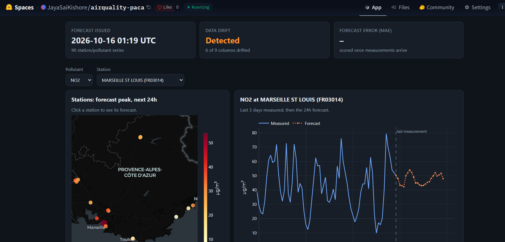
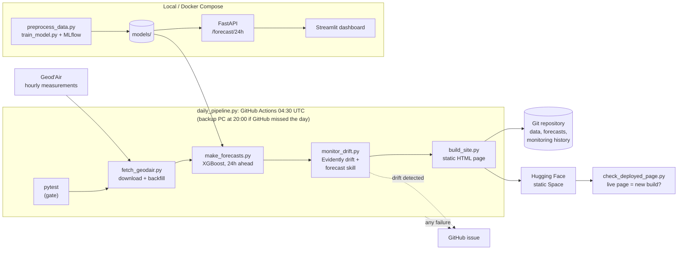
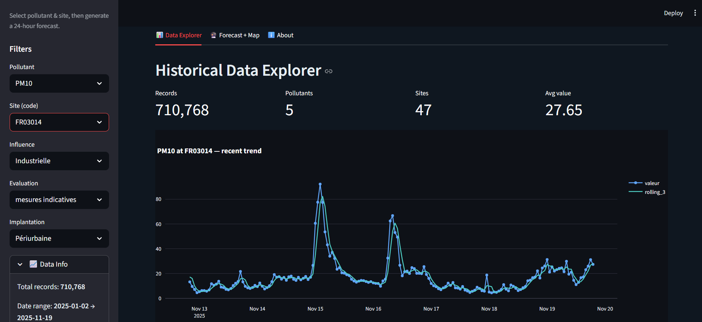
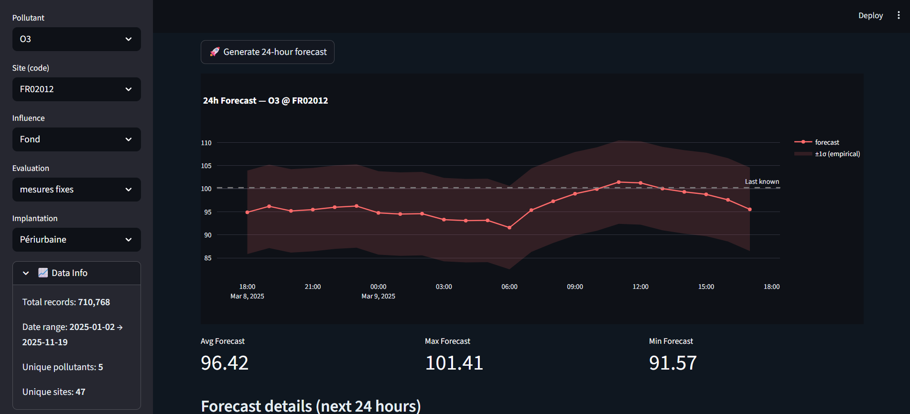

# Air Quality Forecasting: PACA, France

[](https://huggingface.co/spaces/JayaSaiKishore/airquality-paca)
[](https://github.com/JayaSaiKishore7/AirQuality_AnalysisFR/actions/workflows/ci.yml)
[](https://github.com/JayaSaiKishore7/AirQuality_AnalysisFR/actions/workflows/daily-forecast.yml)
[](https://www.python.org/)
[](LICENSE)

24-hour forecasts of hourly pollutant concentrations (NO₂, O₃, PM10, PM2.5, CO) for the ATMO SUD monitoring
stations in the Provence-Alpes-Côte d'Azur (PACA) region, refreshed every day from live government data.

**▶ [Open the live demo](https://huggingface.co/spaces/JayaSaiKishore/airquality-paca)**



## What it does

- **Pulls live data daily.** A GitHub Actions job downloads the latest hourly measurements from
  [Geod'Air](https://www.data.gouv.fr/datasets/5b98b648634f415309d52a50), the French national air quality database.
- **Forecasts the next 24 hours** for about 90 station/pollutant series with an XGBoost model.
- **Monitors itself.** [Evidently](https://www.evidentlyai.com/) checks whether recent data has drifted away from the training
  data, and old forecasts are scored against what was actually measured. Drift opens a GitHub issue automatically.
- **Publishes the results** as a static page (Plotly charts and map) on a free Hugging Face Space,
  then checks that the live page really shows the new forecast.
- **Fails safely and loudly.** Tests gate every publish; a failed run leaves the previous page online, opens a
  GitHub issue, and the page itself warns visitors when its forecast is more than 36 hours old.

## Architecture



## Release and operations

Everything runs on free tiers. Full runbook (failure handling, rollback, secrets): [docs/RELEASE.md](docs/RELEASE.md).

- **Pull requests:** `main` is protected; changes go through a pull request and CI must pass:
  `lint` (ruff), `test` (pytest with the exact versions in `constraints.txt`), and `docker` (both images
  built, health-checked and smoke-tested with a real forecast). CI also uploads a **preview** of the page
  built from the pull request.
- **Daily update:** GitHub Actions runs [`scripts/daily_pipeline.py`](scripts/daily_pipeline.py): tests,
  fetch (automatically backfilling missed days), forecast, drift check, build, commit, deploy, then verify the
  live page. A free **backup runner** on a PC ([`scripts/run_local_backup.ps1`](scripts/run_local_backup.ps1))
  publishes in the evening only if GitHub has not, and sends a Windows notification when it does.
- **When something fails:** the previous page stays online, a `pipeline-failure` issue is opened, and the
  page shows an "out of date" banner after 36 hours.
- **Rollback:** Actions → *Deploy to Hugging Face Spaces* → *Run workflow* with `ref` = the last good commit,
  or revert in the Space's file history (works even when GitHub Actions is down).

## Tech stack

| Area | Tools |
|---|---|
| Data & ML | pandas, NumPy, scikit-learn, XGBoost |
| Monitoring | Evidently |
| Serving | FastAPI, Streamlit |
| Visualisation | Plotly (Python and Plotly.js) |
| Experiments | MLflow (training runs), TensorFlow/Keras (LSTM/GRU comparison notebook) |
| Testing & quality | pytest, ruff, Docker smoke test, post-deploy page check |
| Automation & deployment | GitHub Actions, Docker Compose, Hugging Face Spaces, Windows Task Scheduler (backup) |

## Model

- **Target:** hourly concentration per station and pollutant.
- **Features:** station coordinates and type, pollutant, calendar features (hour, day, month, weekday, weekend),
  and recent history (value 1 h and 24 h earlier, mean of the previous 3 hours). Every feature uses only
  data from before the hour being predicted.
- **Per-pollutant scaling:** concentrations differ ~100× between pollutants (CO ≈ 0.2 mg/m³, O₃ ≈ 70 µg/m³).
  The target and history features are divided by each pollutant's median training level, so the model weighs
  every pollutant equally; predictions are converted back to real units.
- **Training:** Random Forest and XGBoost compared on a chronological 80/20 split. The best model by RMSE that is
  small enough to deploy is saved (XGBoost, 4.8 MB; the Random Forest scores slightly better but is 278 MB).
  Forecasts are made recursively, one hour at a time, for 24 hours.
- **Data:** ATMO SUD hourly measurements, January–November 2025.

### Results

Baseline: **persistence**, which repeats the last measured value. A useful model has to beat it.

**1 hour ahead**, held-out test set (14 Sep – 19 Nov 2025, 135,432 hourly values):

| Model | MAE | RMSE | R² |
|---|---|---|---|
| **XGBoost (deployed)** | **3.69** | **6.45** | **0.931** |
| Random Forest | 3.66 | 6.36 | 0.933 |
| Persistence baseline | 3.99 | 7.20 | 0.915 |

**24 hours ahead**, live Geod'Air data: 20 daily forecasts issued 16 Oct – 4 Nov 2026, scored against what was
then measured (40,871 hourly values). Mean absolute error:

| Pollutant | XGBoost | Persistence | Improvement |
|---|---|---|---|
| PM10 (µg/m³) | 5.2 | 7.4 | 30% |
| NO₂ (µg/m³) | 7.6 | 10.8 | 29% |
| O₃ (µg/m³) | 14.7 | 20.2 | 27% |
| CO (mg/m³) | 0.051 | 0.059 | 13% |
| PM2.5 (µg/m³) | 3.4 | 3.8 | 10% |
| **All** | | | **26%** |

The model beat persistence on 18 of the 20 days (daily improvement from −17% to +56%, median 27%).
No forecasts exist for 5–16 Nov 2026, when the daily job did not run. The pipeline keeps scoring every
forecast and publishes the running error for the last 7 days on the live page.

**Known limitations:**
- PM2.5 gains the least (10%) and CO is measured at few stations (820 values above).
- Some days the model is worse than persistence (2 of 20 days so far).
- Live data is raw (unvalidated) while the training data is validated, which is one reason drift is detected.
- Only stations seen during training can be forecast.

An earlier version leaked the target: the 3-hour mean included the hour being predicted. Fixing it lowered the
1-hour test score (MAE 3.42, inflated by the leak, → 3.69), but training and forecasting now see the same inputs:
before the fix, a 24-hour backtest beat persistence by only 5–14%. A test in `tests/test_features.py` guards
against the leak coming back.

## Quick start

```bash
git clone https://github.com/JayaSaiKishore7/AirQuality_AnalysisFR.git
cd AirQuality_AnalysisFR
docker compose up --build
```

Then open the dashboard at http://localhost:8501 and the API docs at http://localhost:8000/docs.

**Without Docker:**

```bash
python -m venv .venv
source .venv/bin/activate          # Windows: .venv\Scripts\activate
pip install -r requirements-dev.txt -c constraints.txt

pytest                             # run the tests
ruff check .                       # lint (pip install ruff==0.17.3)
streamlit run app.py               # dashboard (works with or without the API)
uvicorn Api.main:app --port 8000   # API, see docs/API.md
```

**Run the daily pipeline locally** (without publishing anything):

```bash
python scripts/daily_pipeline.py --dry-run   # tests, fetch, forecast, drift check, build site/index.html
```

or step by step:

```bash
python scripts/fetch_geodair.py    # last 3 days, or back to the last stored day
python scripts/make_forecasts.py
python scripts/monitor_drift.py
python scripts/build_site.py       # then open site/index.html
```

Both write data files in your working copy; discard them with `git checkout -- data site monitoring`.

**Check the live page** (exits non-zero if it is unreachable, broken or older than 36 hours):

```bash
python scripts/check_deployed_page.py --url https://jayasaikishore-airquality-paca.static.hf.space/ --attempts 1
```

**Contributing:** create a branch, open a pull request (e.g. `gh pr create`), and merge once CI is green.
Direct pushes to `main` are rejected.

**Retrain:**

```bash
python scripts/preprocess_data.py  # rebuilds data/processed/ from the monthly files in data/raw/
python scripts/train_model.py      # logs runs to MLflow: mlflow ui --backend-store-uri sqlite:///mlflow.db
python scripts/build_reference.py  # refreshes the drift reference
```

## Project structure

```
├── airquality/            Shared package: features, Geod'Air client, forecasting, drift, static page
├── Api/                   FastAPI backend
├── app.py                 Streamlit dashboard
├── scripts/               Pipeline (daily_pipeline.py), deploy, checks, backup runner, training
├── tests/                 pytest suite
├── data/
│   ├── raw/               Monthly Geod'Air exports, 2025
│   ├── processed/         Cleaned training data
│   ├── reference/         Station coordinates, drift reference sample
│   └── live/              Daily observations and forecasts (updated by the pipeline)
├── models/                Trained model and label encoders
├── monitoring/            Drift and forecast-skill history
├── site/                  Generated static page (deployed to Hugging Face)
├── notebooks/             Exploratory analysis and LSTM/GRU experiments
├── deploy/huggingface/    Hugging Face Space card
├── docs/
│   ├── API.md             API reference
│   └── RELEASE.md         Release process, failure handling, rollback, secrets
├── .github/
│   ├── workflows/         CI, daily pipeline, deployment / rollback
│   ├── rulesets/          Branch protection for main (importable JSON)
│   └── dependabot.yml     Weekly updates for the pinned GitHub Actions
└── constraints.txt        Exact, tested versions of every Python package
```

| Requirements file | Used for |
|---|---|
| `requirements-api.txt` | FastAPI backend (Docker image) |
| `requirements-pipeline.txt` | Daily pipeline and tests (GitHub Actions, backup runner) |
| `requirements.txt` | Streamlit dashboard |
| `requirements-dev.txt` | Everything above, plus MLflow and the notebooks |
| `constraints.txt` | Exact tested versions; pass with `-c constraints.txt` to any of the above |

Configuration is optional: every setting has a default. See [`.env.example`](.env.example).

## Screenshots

Local Streamlit dashboard:

| Historical data explorer | 24-hour forecast |
|---|---|
|  |  |

## License

[MIT](LICENSE)
