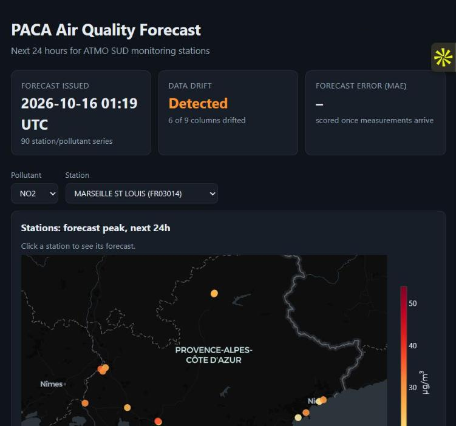
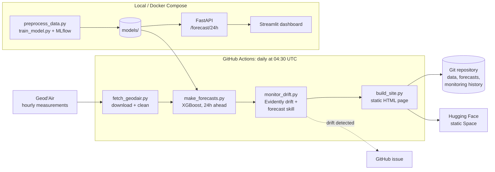
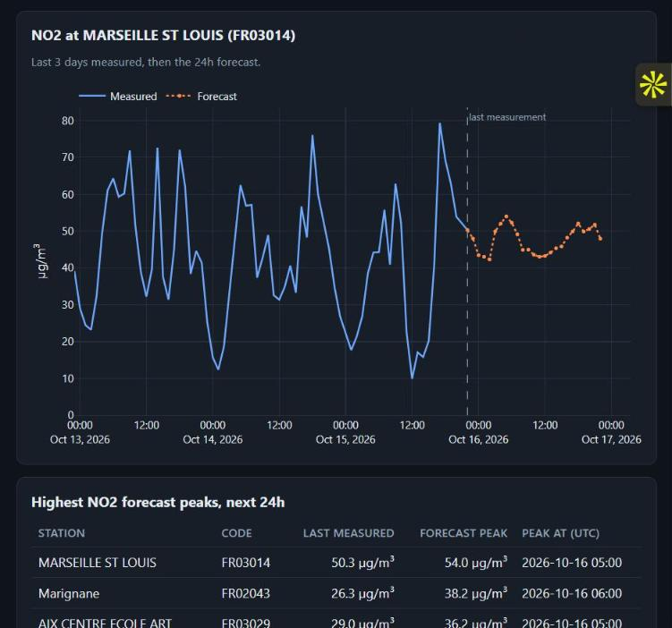
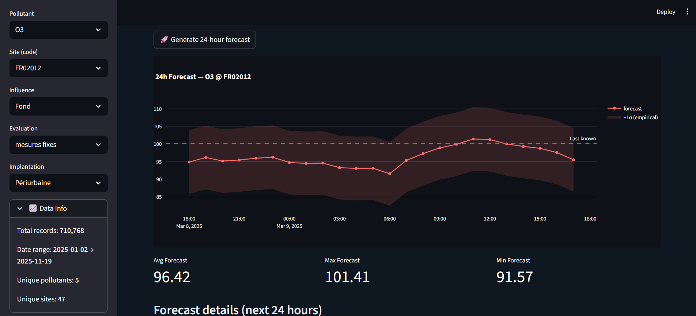

# Air Quality Forecasting: PACA, France

[](https://huggingface.co/spaces/JayaSaiKishore/airquality-paca)
[](https://github.com/JayaSaiKishore7/AirQuality_AnalysisFR/actions/workflows/ci.yml)
[](https://github.com/JayaSaiKishore7/AirQuality_AnalysisFR/actions/workflows/daily-forecast.yml)
[](https://www.python.org/)
[](LICENSE)

24-hour forecasts of hourly pollutant concentrations (NO₂, O₃, PM10, PM2.5, CO) for the ATMO SUD monitoring
stations in the Provence-Alpes-Côte d'Azur (PACA) region, refreshed every day from live government data.

**▶ [Open the live demo](https://huggingface.co/spaces/JayaSaiKishore/airquality-paca)**



## What it does

- **Pulls live data daily.** A GitHub Actions job downloads the latest hourly measurements from
  [Geod'Air](https://www.data.gouv.fr/datasets/5b98b648634f415309d52a50), the French national air quality database.
- **Forecasts the next 24 hours** for about 90 station/pollutant series with an XGBoost model.
- **Monitors itself.** [Evidently](https://www.evidentlyai.com/) checks whether recent data has drifted away from the training
  data, and old forecasts are scored against what was actually measured. Drift opens a GitHub issue automatically.
- **Publishes the results** as a static page (Plotly charts and map) on a free Hugging Face Space.

## Architecture



Every push and pull request runs the test suite (`ci.yml`).

## Tech stack

| Area | Tools |
|---|---|
| Data & ML | pandas, NumPy, scikit-learn, XGBoost |
| Monitoring | Evidently |
| Serving | FastAPI, Streamlit |
| Visualisation | Plotly (Python and Plotly.js) |
| Experiments | MLflow (training runs), TensorFlow/Keras (LSTM/GRU comparison notebook) |
| Testing | pytest |
| Automation & deployment | GitHub Actions, Docker Compose, Hugging Face Spaces |

## Model

- **Target:** hourly concentration per station and pollutant.
- **Features:** station coordinates and type, pollutant, calendar features (hour, day, month, weekday, weekend),
  and recent history (value 1 h and 24 h earlier, 3-hour rolling mean).
- **Training:** Random Forest and XGBoost compared on a chronological 80/20 split. The model with the lower RMSE
  (XGBoost) is saved to `models/best_model.pkl`. Forecasts are made recursively, one hour at a time.
- **Data:** ATMO SUD hourly measurements, January–November 2025.

**Known limitations, being worked on:**
- The 3-hour rolling-mean feature includes the hour being predicted, which leaks the target during training.
  A fix and retraining are in progress, so no accuracy figures are published yet.
- Live data is raw (unvalidated) while the training data is validated, which is one reason drift is detected.
- Only stations seen during training can be forecast.

## Quick start

```bash
git clone https://github.com/JayaSaiKishore7/AirQuality_AnalysisFR.git
cd AirQuality_AnalysisFR
docker compose up --build
```

Then open the dashboard at http://localhost:8501 and the API docs at http://localhost:8000/docs.

**Without Docker:**

```bash
python -m venv .venv
source .venv/bin/activate          # Windows: .venv\Scripts\activate
pip install -r requirements-dev.txt

pytest                             # run the tests
streamlit run app.py               # dashboard (works with or without the API)
uvicorn Api.main:app --port 8000   # API, see docs/API.md
```

**Run the daily pipeline locally:**

```bash
python scripts/fetch_geodair.py --days 3
python scripts/make_forecasts.py
python scripts/monitor_drift.py
python scripts/build_site.py       # then open site/index.html
```

**Retrain:**

```bash
python scripts/preprocess_data.py  # rebuilds data/processed/ from the monthly files in data/raw/
python scripts/train_model.py      # logs runs to MLflow (mlflow ui)
python scripts/build_reference.py  # refreshes the drift reference
```

## Project structure

```
├── airquality/            Shared package: features, Geod'Air client, forecasting, drift, static page
├── Api/                   FastAPI backend
├── app.py                 Streamlit dashboard
├── scripts/               Pipeline, training and helper scripts
├── tests/                 pytest suite
├── data/
│   ├── raw/               Monthly Geod'Air exports, 2025
│   ├── processed/         Cleaned training data
│   ├── reference/         Station coordinates, drift reference sample
│   └── live/              Daily observations and forecasts (updated by the pipeline)
├── models/                Trained model and label encoders
├── monitoring/            Drift and forecast-skill history
├── site/                  Generated static page (deployed to Hugging Face)
├── notebooks/             Exploratory analysis and LSTM/GRU experiments
├── deploy/huggingface/    Hugging Face Space card
├── docs/API.md            API reference
└── .github/workflows/     CI, daily pipeline, deployment
```

| Requirements file | Used for |
|---|---|
| `requirements-api.txt` | FastAPI backend (Docker image) |
| `requirements-pipeline.txt` | Daily pipeline and tests (GitHub Actions) |
| `requirements.txt` | Streamlit dashboard |
| `requirements-dev.txt` | Everything above, plus MLflow and the notebooks |

## Screenshots

| Measured vs. forecast (live page) | Local Streamlit dashboard |
|---|---|
|  |  |

## License

[MIT](LICENSE)
